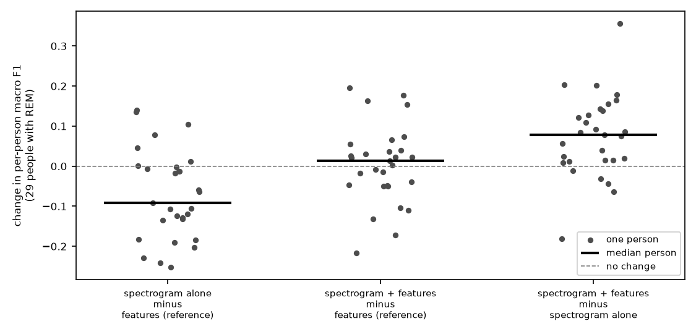
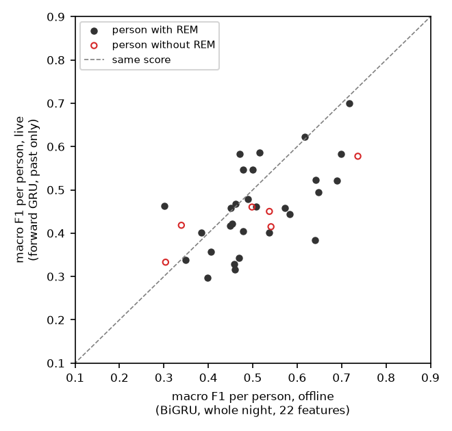
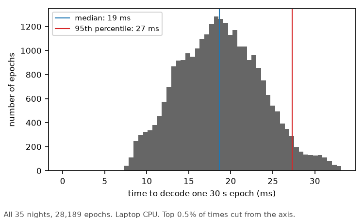

# Sleep staging from a wrist pulse signal, offline and live

Three-class sleep staging (wake, NREM, REM) from a wrist-worn pulse sensor, on the DREAMT dataset. It includes a streaming decoder that works on a live signal.

The main point of the project is the method, not the score. People are split into folds, so no one is ever scored by a model that saw them. Every comparison is paired per person. Every function has a hand-computed test.

## What is here

- A pipeline from raw 64 Hz wrist signals to 30 s epochs: pulse filtering, beat detection, beat quality checks, heart-rate-variability features, movement, temperature and skin conductance.
- Models: a logistic regression baseline, a CNN + BiGRU that reads a whole night, and a small spectrogram encoder that joins the BiGRU.
- A streaming decoder that uses only the past. It reads six channels over LSL and outputs a stage every 30 s, or "no guess" when the signal is too poor.
- Notebooks `01` to `10`, in order, with the analysis and figures.

## How results are measured

- 35 people from DREAMT. Five folds, split by person: 24 train, 4 validation and 7 test people in each.
- Main number: the median over people of the per-person macro F1. Also pooled kappa and REM recall.
- 6 of the 35 people have no REM. A model that never predicts REM does better on them, so comparisons are also reported on the 29 people who have REM.
- Differences between models are paired per person, with a bootstrap 95% interval.

## Results

All numbers come from the notebooks named in brackets. Every run uses one random seed.

**Best offline model** (notebook 09): the BiGRU with handcrafted features plus a pulse and movement spectrogram encoder. Median per-person macro F1 0.512, pooled kappa 0.364. Its per-person gain over the BiGRU with features only was not established (+0.013, 95% interval -0.040 to +0.030, 29 people with REM). For reference, Tallal et al. 2026 (Sensors 26:5746) report kappa 0.327 for a handcrafted-feature model on 99 DREAMT people.



**Features** (notebook 08): of four added feature families, heart rate over several minutes was the only one with a clear gain. +0.045 per person (95% interval +0.029 to +0.070), 24 of 29 people better.

**Live decoding** (notebook 10): a forward-only GRU that sees only the past. On the same 22 features, kappa is 0.265 live against 0.344 offline. The per-person macro F1 change is -0.047 (95% interval -0.116 to -0.009).



The streaming decoder gives the same stage as the batch calculation on all 28,189 epochs. It takes 19 ms per epoch (median), the model is 158 KB, and a night decodes about 179 times faster than real time.



## What did not work

- Pulse amplitude as a feature: +0.002 per person.
- A CNN on beat intervals alone: worse than logistic regression.
- Class weights from the literature made the BiGRU stop predicting REM. Balanced weights fixed it.
- The spectrogram model alone, with 35 people: worse than the handcrafted features (-0.092 per person on the 29 with REM).

## Known limits

- 35 people, one sleep clinic, one device.
- One seed per result, so small differences are not reliable.
- The live quality gate is more lenient than the offline one. Its shape threshold was set with a different filter. Not fixed.
- The agreement between the streaming and the batch decoder checks the code, not sleep accuracy.

## Data

DREAMT is not included. It is restricted data under the PhysioNet Restricted Health Data License, which does not allow sharing it. Nothing computed from it (features, spectrograms, per-epoch predictions) is in this repository either. The one exception is the five small trained models in `models/live/`.

1. Get access to DREAMT 2.2.0 on PhysioNet: https://physionet.org/content/dreamt/2.2.0/
2. Put the download in `data/raw/`, keeping PhysioNet's folder layout. Or set the environment variable `DREAMT_ROOT` to wherever it is.
3. The notebooks use every wristband file they find, and notebook 05 checks the exact total of 28,189 epochs. Keep only these 35 people: S006, S009, S010, S012, S013, S014, S015, S021, S022, S024, S030, S032, S035, S042, S045, S047, S055, S058, S061, S064, S070, S072, S074, S075, S080, S085, S086, S093, S094, S096, S097, S100, S101, S102, S103.

## Running it

```
uv sync
uv run pytest
```

The tests use synthetic signals and need no data. The notebooks need the data, and each one builds on files the earlier ones save, so run them in order. The slowest steps are model training in notebook 09 (about an hour) and the all-night streaming run in notebook 10.

The live demo decodes a wrist signal as it arrives over LSL. It uses the five models in `models/live/`, with `folds.json`, the list of which people each model was trained on. The models were trained on DREAMT. The data itself is not included.

```
uv run python scripts/live_demo.py --synthetic --minutes 20      # a made-up signal, needs no data
uv run python scripts/live_demo.py --person S014 --minutes 20    # a DREAMT person, decoded by the model that never saw them
uv run python scripts/live_demo.py --lsl MY_STREAM               # your own LSL stream (see below)
```

The synthetic signal shows streaming, timing and the "no guess" behaviour only. The stages it gives mean nothing, because the model never saw a made-up pulse. For `--lsl`, the stream needs six channels (BVP, ACC_X, ACC_Y, ACC_Z, TEMP, EDA) at 64 Hz, as an Empatica E4 gives.

## Code layout (`src/`)

| module | what it does |
|---|---|
| `recording.py`, `preprocess.py` | load one person's night; filtering and epoching |
| `beats.py`, `quality.py` | beat detection, interval cleaning, epoch quality gate |
| `features.py`, `families.py`, `groups.py` | per-epoch features and the extra feature families |
| `spectro.py` | pulse and movement spectrograms |
| `models.py`, `sequence.py` | baselines; CNN + BiGRU, spectrogram encoder, forward-only GRU |
| `splits.py`, `evaluation.py`, `metrics.py` | person folds, scoring, paired bootstrap |
| `stream.py`, `live_features.py`, `live.py` | filter and beat detector for streams, live features, the streaming decoder |
| `identity.py`, `timing.py` | how much a model recognises the person; clock timing between files |
| `synthetic.py` | made-up wrist recordings for tests and the no-data demo |
| `config.py` | all settings in one frozen object |

`models/live/` holds the five forward-only models and `folds.json`. `scripts/live_demo.py` is the demo.
